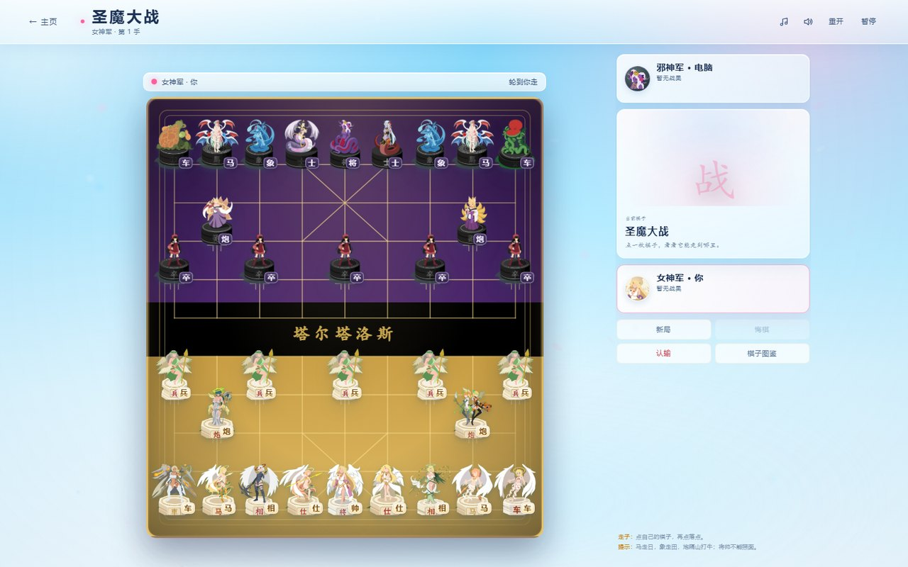
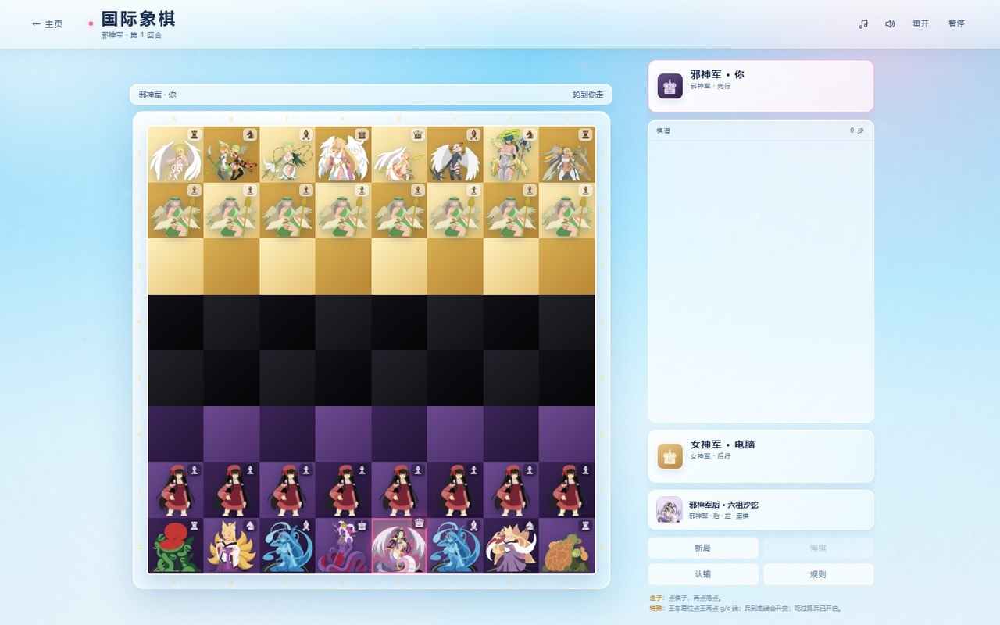
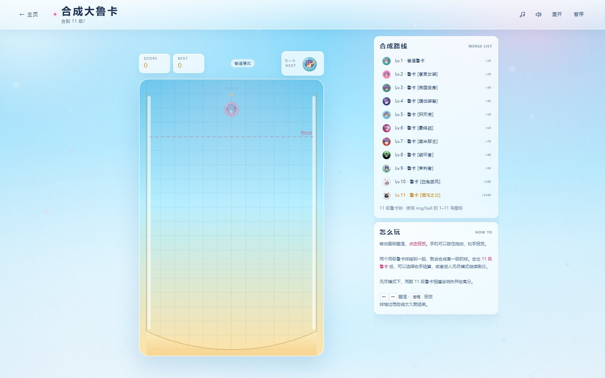
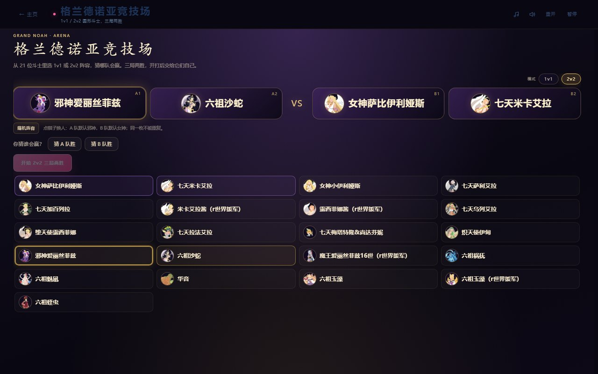
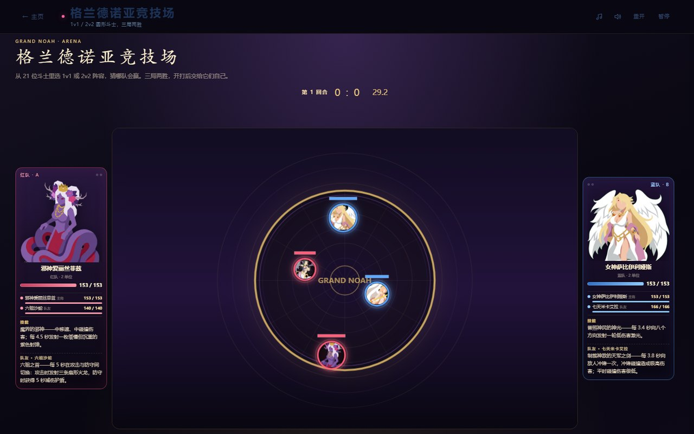
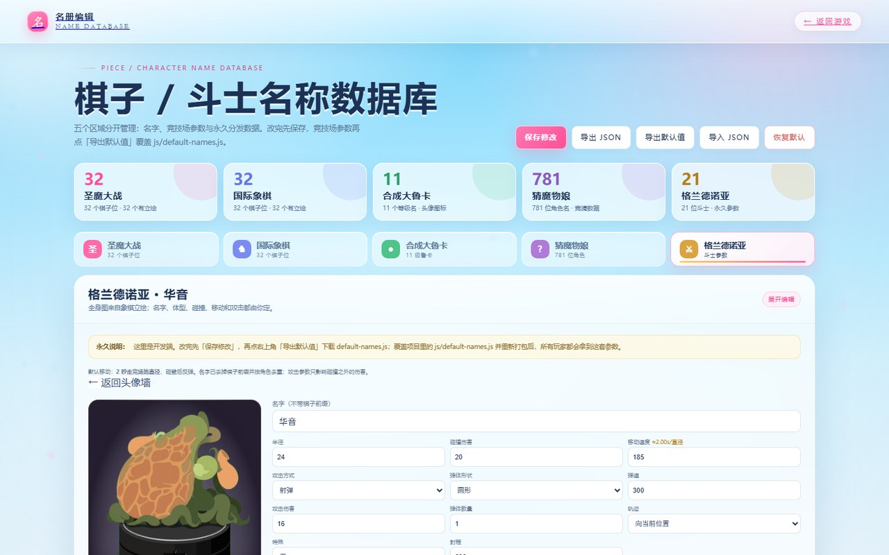
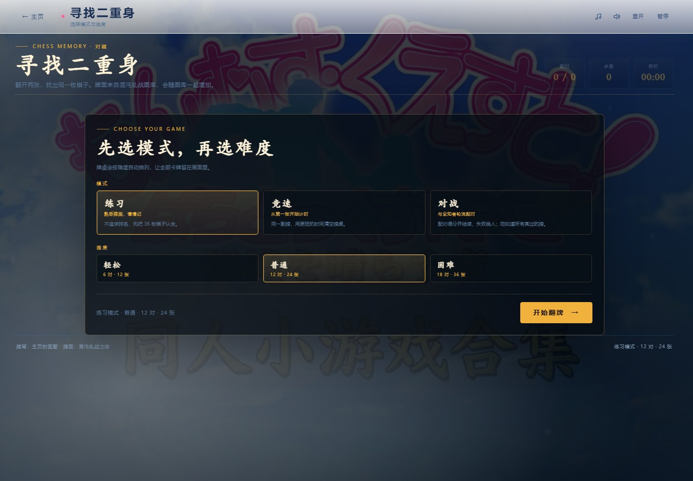
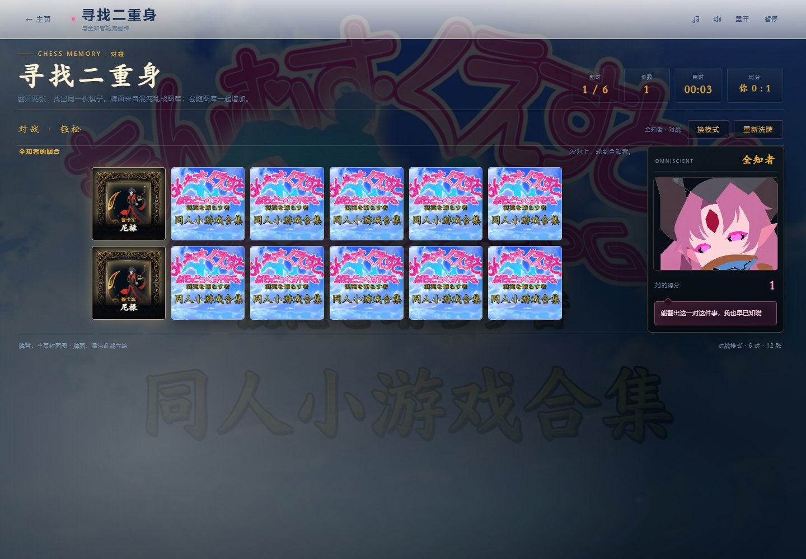
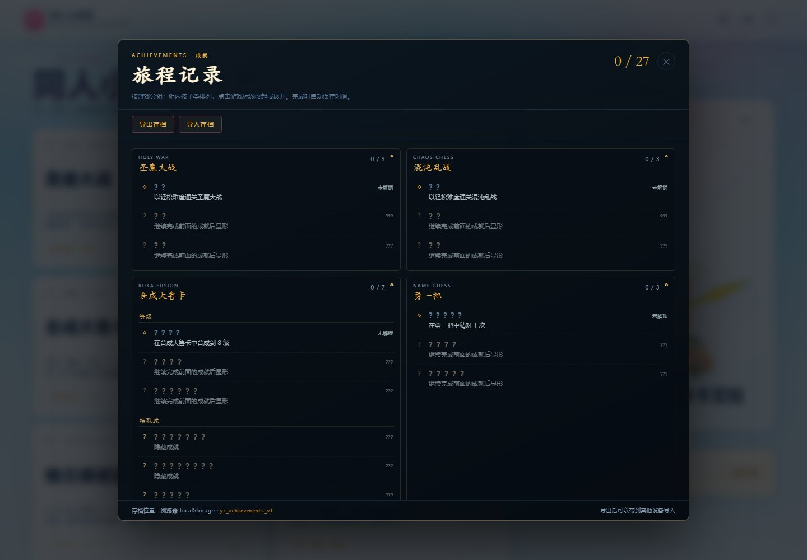
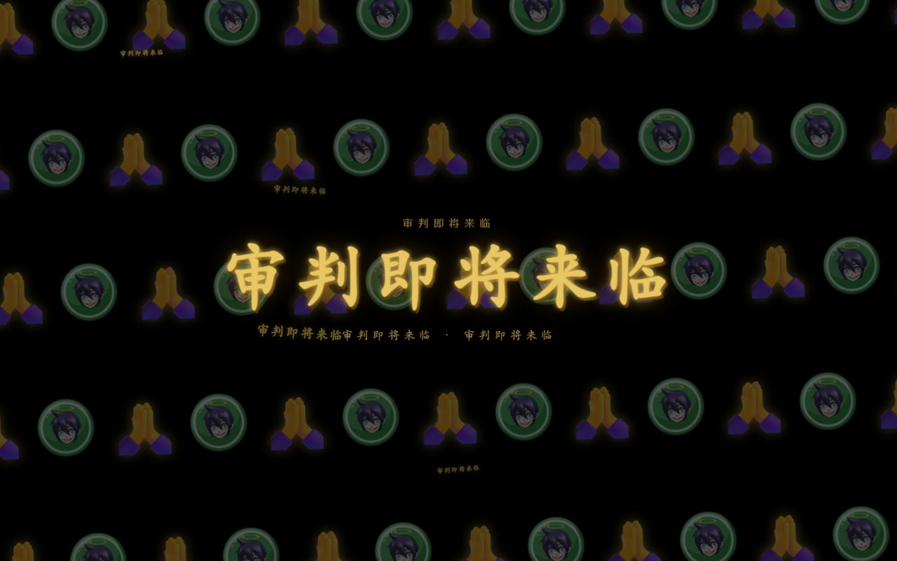

# 同人小游戏合集 · 六合一

一个纯前端的六合一迷你游戏合集。开场直接铺满 `img/System/title.jpg`，底部闪动「按任意键开场」；按键后进入主页：左侧两列游戏列表，右侧随机展示一枚棋子，设置项直接放在主页下方。没有构建步骤，也不需要联网。

## 运行

**最简单：** 双击 `start.bat`，或直接用 Chrome / Edge 打开 `index.html`。

页面使用传统 `<script>` 加载，`file://` 直接打开也能玩。如果浏览器对本地文件的 `localStorage` 限制较严，可以在目录里启动本地服务器：

```bash
python -m http.server 8000
```

然后访问 `http://localhost:8000`。

## 预览














更多截图在 `screenshots/` 目录。

## 六个游戏

### 01 · 圣魔大战（原中国象棋）

- 女神军（原红方）对邪神军（原黑方）；开局可以选边和难度，选邪神军时电脑执红先行。
- 32/32 个棋子位都有图；五个兵按颜色共用（女神军 WS、邪神军 BP），白车使用新 WC。
- 执黑时棋盘会翻转，己方始终在下方。
- 选中棋子时棋子身体会半透明，方便看清身前落点。
- 棋盘为紫色（邪神军）/金色（女神军）两端，中间纯黑河界，河界文字为「塔尔塔洛斯」。
- 完整中国象棋规则：马腿、象眼、炮架、九宫、将帅照面、将军、绝杀、困毙、悔棋、认输。
- 困难模式同样强化了搜索深度、静态搜索、将军延伸和杀手/历史排序，并加入通路兵、开放线、王前守子评估。
- 俯视棋盘 + 立绘伪立体棋子：32 个棋子位全部有立绘；五个兵按颜色共用同一张兵图（女神军 WS、邪神军 BP），白车新增 WC。
- 棋子名字全部来自「棋子名称数据库」，按每个棋子位分别命名；同功能左右两枚棋子可以不同名，名字会跟着棋子移动。
- 棋子详情只显示名字 / 阵营 / 位置，不再写随机台词。
- 初始走法数校验：44 / 1920 / 79666。

### 02 · 混沌乱战

- 女神军执白、邪神军执黑；开局可以选边和难度；每局抛硬币随机决定先手，不再固定白先。
- 执黑时棋盘和坐标会翻转，己方始终在下方。
- 执白/执黑只决定玩家颜色和棋盘方向，不决定先后手。
- 棋盘前 3 行按阵营上色：邪神军紫、女神军金；中间 2 行纯黑。
- 完整规则：王车易位、吃过路兵、兵升变、将杀、逼和、五十回合、三次重复、子力不足。
- 困难模式参考了参考游戏内置 Stockfish 的搜索/评估思路，强化了迭代加深、静态搜索、将军延伸、杀手/历史排序和通路兵、开放线、王前兵盾评估。
- 棋子改用象棋角色的去底座立绘：王←帅/将，白后←P（WP），黑后←BP1 去底图，马复制象棋炮位的图和名字，象←相，车←车，兵按颜色共用同一张（白 WS / 黑 BP）；P2 不用。
- 32/32 个棋子位都有角色图，每个棋子右上角有象棋类型小标记。
- 默认名字格式：`女神军/邪神军 + 棋子名 · 名字`，例如「女神军王 · 女神萨比伊利娅斯」「邪神军后 · 六祖沙蛇」「女神军马 · 七天拉法艾拉」。
- 初始走法生成校验：20 / 400 / 8902。

### 03 · 合成大鲁卡

- 11 个等级使用 `img/ball/1.png` … `11.png` 的鲁卡头像球。
- 主页入口图标会在 1–11 号鲁卡头像之间轮播，点击可晃动，连点 7 次进入审判彩蛋。
- 底部是弧形球碗，球会沿弧面互相挤压、滚动。
- 11 个等级，同级球碰撞后升级。
- 合出 11 级鲁卡时可以选择「收手结算」或「进入无尽模式」。
- 无尽模式下，两颗 11 级鲁卡相撞会消失并给高分；普通模式仍按危险线判负。
- 特殊球：普罗米斯汀（绿）碰到第一颗球使其升级；伊娃（石灰色）不可合成，作为占位石；蛭虫（鲜红）碰到第一颗球使其消失。
- 球体使用 `img/ball/1–11.png` 的角色图标，半径与等级绑定；底部是弧形球碗，球会沿弧面互相挤压、滚动。
- 右侧「下一个」显示下一颗预告，当前瞄准的是当前这颗；球堆越过危险线并停留约 2 秒会结束。
- 11 个等级的名字来自名称数据库。

### 04 · 勇一把

- 数据来自 `data/guessdata.xlsx`，按名称去重后共 **781** 位角色。
- 输入框 + 七个气泡：种族 / 世界 / CG 个数 / 性别 / 形态数量 / 胸部大小 / 名称字数。
- 最多猜 **7** 次；输入时会弹出近似名字的下拉框，点击或方向键选择后填入。
- 顶部实时记录「已错 N 次」，结算时也会显示本局错了几次。
- 七个主气泡下方会保留前面的失败条目：每条带 7 个迷你气泡和名字，最多 6 条（7 次机会中除当前这次外的全部失败）。
- 气泡颜色：绿色 = 命中，黄色 = 接近，红色 = 不接近；数字项会显示 ↑ / ↓ 提示答案更大或更小。
- 名称字数示例：答案 2 字，猜 3 字 → 黄色「3 ↓」；猜 5 字 → 红色「5 ↓↓」。
- 种族按大类判断接近度，例如人类 → 精灵为黄色，人类 → 虫为红色。
- 译名可以不完全准确：例如鲁卡 / 卢卡、带不带「・」都能识别；只要字数一致且差异很小。
- 结算时会从 `img/guess_head/` 按答案原名贴出对应头像（改名只在显示上生效，头像仍用数据源原名匹配）。
- 有「提示 · 看轮廓」按钮（也可按 `H`）：消耗 3 次猜测，显示答案的黑色剪影；失败记录与结算仍保留。

### 05 · 格兰德诺亚竞技场

- 连猜模式：先选一套阵容，之后每场都猜 A/B 胜；猜对可继续猜同一套阵容，猜错结束。连猜期间不能重抽，运筹帷幄需要连猜连赢 10 场。
- 乌列艾拉：每 2.5 秒向八方向发射伤害 10 的光弹，每 2 秒发射伤害 10 的激光，不再普通射击。
- 梅塔特隆&尚达芬妮：未分开时使用双头立绘；分开后梅塔特隆为移动方、尚达芬妮为静止激光方，使用各自单人头像。
- 任意一方有单位倒下后，对方存活单位攻速翻倍。
- 露西菲娜的行星出现后会先在自身位置停留 1 秒（带碰撞框），随后才发射。


- 圆形场地自动对战；支持 1v1 与 2v2。玩家先选阵容（A 队默认邪神、B 队默认女神），再猜哪队赢。
- 三局两胜；每局 30 秒，时间到后不结算，双方进入「狂暴」：受到的伤害 ×2、移动速度 ×2、子弹速度 ×2，直到一方倒下。
- 2v2 时每队两名成员同时上场；选中槽位会高亮，A 队用金色标记、B 队用紫色标记；全队倒下才判负。
- 所有飞行道具都绘制在角色上层并带高亮核心；命中判定只对敌方槽位生效，死亡角色会立即从场地移除。
- 灼烧、麻痹、冰冻、水弱化、护盾、无敌、明星、魅惑、减速、治疗、蓄力、冲锋、防御、加速、增伤等状态会在角色头顶显示对应图标。
- 拉菲艾拉固定原地，不会被碰撞推走；六祖玉藻与拉菲艾拉的技能都带追踪判定，避免移动目标完全躲开。
- 斗士由圣魔大战 21 位 + 鲁卡军/卡奥斯军各 9 位组成，共 39 位；竞技场头像和全身图直接使用对应势力立绘。
- 场地半径为原先的 2/3，圆形以等比例绘制；默认移动让斗士 **2 秒走完新直径（速度 185）**，匀速直线，碰壁后反弹并带随机偏角，避免绕圈；不再追逐目标。
- 攻击可自定义：方式（射弹 / 激光 / 随机陷阱 / 无）、形状（圆形 / 针形 / 激光）、弹速、伤害、数量、轨迹（当前位置 / 前方 / 随机 / 四方向 / 八方向）、特殊（反射 / 分裂 / 分身 / 吸血）和射程。
- 战斗中场地两侧显示双方全身卡、血条、比分和技能描述；技能已按角色描述实现，并在名称库中保留可编辑描述。
- 堕天使露西菲娜的行星使用大尺寸 `planet.png`；核动力双子拆开后，梅塔特隆用左侧头像、尚达芬妮用右侧头像。
- 华音由原来的左臂、右臂合并；华音、六祖祸抚、核动力双子会拆成可受击的多个分体，必须清空所有分体才判负。
- 竞技场音乐为 `audio/boss_chaos5.ogg`；圣魔大战与混沌乱战的女神军改用 `dungeon_irias.ogg`；混沌乱战鲁卡军/卡奥斯军分别使用 `boss_chaosruka2.ogg` / `singun_kessen_g.ogg`。胜负只用于竞猜结算，玩家不直接操控棋子。
- 开局双方出生点更靠近场地中心；子弹有概率产生角度偏移；射弹不再追踪敌人，拉菲艾拉的针弹与激光已削弱。
- 竞技场改为全屏黑底；选人界面保留头像并放大名字；战斗侧卡显示血量数字、红蓝队伍色和全部存活单位血条；2v2 同时显示两名角色的技能；加百列改为约半场大小的绿色团队治疗领域。
- 场上角色边框按红队 / 蓝队着色；炽天使伊甸的圣枪改为枪形弹道并提高到 65% 最大生命伤害。
- 竞技场不再使用带底座的圣魔大战棋子图，六张圣魔大战全身图已裁成无座角色图，正常情况下不再出现符号棋子；死亡单位会从索敌列表移除。
- 米卡艾拉的天军之剑冲锋伤害改为统一碰撞伤害，主将、队友和分体碰撞都能触发，每次冲锋只结算一次高伤害。
- 炽天使伊甸的圣枪已修复出伤；蓄力、护盾、无敌、灼烧、冰冻、麻痹、治疗、魅惑、减速、冲刺等状态都有场上特效。

### 06 · 寻找二重身

- 牌背直接使用主页封面图 `img/System/title.jpg`，不叠遮罩、不写字。
- 牌面全部调用混沌乱战立绘：女神军、邪神军、鲁卡军、卡奥斯军各 9 枚，共 36 枚可入池；统一裁成 512×512，套 AI 生成的 `frame.png` 花纹卡框。
- 游戏开始前先选模式与难度；牌桌按难度增加列数，6/8/9 列分别对应 6/12/18 对，全部卡牌留在屏幕内。
- 三种模式：
  - 练习：慢慢记，熟悉牌面。
  - 竞速：从第一张开始计时，记录最快通关。
  - 对战：与「全知者」轮流翻牌，配对成功得 1 分并继续；失败后换人。
- 全知者会记住所有已经亮过的牌；没有已知对子时随机翻，一旦出现已知对子绝不遗漏。
- 全知者头像使用 `img/memory/Omn.png`，置于牌桌右侧，并按翻牌结果说固定台词。
- 三档难度：轻松 6 对 / 普通 12 对 / 困难 18 对；支持最佳记录、暂停、重新洗牌和结算。

## 成就

- 成就自动保存在浏览器 `localStorage` 的 `yz_achievements_v1`，完成时记录获得时间、播放奖励音效，并在页面上方弹出成就提示。
- 主页右侧随机棋子图像下方是白底金字的「旅程记录」入口，点开后才是黑色成就细则窗口；细则按游戏分组，每组可点击收起/展开。支持 **导出存档 / 导入存档**，导出的 JSON 可以带到其他设备。
- 同一游戏入口的成就合并成一组，组内再分「等级 / 特殊球」「难度 / 对战 / 特殊」等子类。
- 未解锁成就的名称显示为等长问号；普通成就仍显示最低级条件，特殊成就在未解锁时连条件一起隐藏。
- 完成低级后会显示下一级，完成高级会同步补全低级；通关成就按铜 / 银 / 金边显示，特殊成就为彩边。
- 成就列表：
  - 圣魔大战 / 混沌乱战：惨胜（轻松）、得胜（普通）、完胜（困难）。
  - 合成大鲁卡：子类「等级」靠近混沌（8 级）、抵达最终（9 级）、混沌之父诞生（11 级）；子类「特殊球」什么被吃了！？、科学被浪费了……、合理的下场、审判来临！。
  - 勇一把：回忆起……、检索工具、阿卡夏记录（猜对 1/5/10 次）。
  - 格兰德诺亚：猜对了！、识人术、运筹帷幄（参加 1 次 / 猜对 10 次 / 连对 10 次）。
  - 寻找二重身：子类「难度」二重身发觉、看透、破除；子类「对战」挑战全知者、成为全知者、超越全知者；子类「特殊」没看答案吗……、摸摸全知者。

## AI 引擎

- 竞技场球体只显示裁好的头部图，卡片仍显示全身；凋零/怨念/鲁卡增伤分别显示骷髅、灰圈、火焰图标。
- 混沌乱战新增鲁卡军、卡奥斯军；棋子图按 `img/chess/art/<势力英文>/<棋子>.png` 存放，已有势力为 `goddess` / `demon`，新势力为 `ruka` / `chaos`。两军各 9 名角色，王名分别为鲁卡/卡奥斯，其余棋子按混沌乱战名为后/象/马/车/兵；保存竞技场名字/技能时会保留势力与立绘索引。
- 混沌乱战开局增加“选择敌人”：四个阵营彼此独立，选完己方势力后可从其余三个阵营中任选敌人。
- 竞技场默认生命统一为 100（技能描述明确写出的阿德拉梅莱克 20/30/40、阿皮洛四个 30 血单位、红 5 等例外除外）；新增 18 名棋子，名字与技能描述全部采用保存数据中的原文：鲁卡半血增伤、布伦希尔德随机双形态弹、伊娃偷攻击、普罗米斯汀四反应烧瓶、希格尔德僚机、马鲁塞勒斯瞬移蓄力、尼禄时停、妮莉丝刀气、索尼娅旋转棍棒、卡奥斯大玉与护眼、EX索尼娅虚化、死神凋零、白兔引导、尼夫塔镰刀、伊迪亚投剑突进、阿德拉梅莱克复活、克莱奥无敌突进、阿皮洛四军分裂。
- 混沌乱战：`vendor/stockfish/` 内置 Stockfish.js 19 lite single-threaded（GPL-3.0），通过 `js/stockfish-ai.js` 的 Web Worker 调用；HTTP(S) 下启用。按《帝国幻想乡》的 Stockfish 配置模仿：Threads=1、Hash=32、UCI_LimitStrength/UCI_Elo、go movetime；最高难度使用全强度与 3 秒思考时间；`file://` 下改用 `vendor/jschess/` 的 js-chess-engine 2.4.6（MIT）纯 JS 搜索，再失败才回退内置搜索。
- 中国象棋：`vendor/xqwlight/` 内置 XiangQi Wizard Light（GPL-2.0），纯 JavaScript，`file://` 和 HTTP 都可运行；通过 `vendor/xqwlight/engine.js` 接到现有棋盘。
- 许可证与来源见 `vendor/README.md` 及各目录的 license 文件。

## 棋子 / 斗士名称数据库（开发者）

打开方式：直接打开 `names.html`。游戏主页和游戏内不再提供入口，避免普通玩家误入；它仍然是开发者用的独立页面。

五个区域分开编辑：

| 区域 | 数量 | 说明 |
|------|------|------|
| 圣魔大战 | 32 个棋子位 + 2 个阵营名 | 女神军 / 邪神军各 16 个棋子位（士、象、马、车、炮左右各一，五个兵各一） |
| 混沌乱战 | 32 个棋子位 + 2 个阵营名 | 白棋 / 黑棋各 16 个棋子位；32/32 有去底座角色图 |
| 合成大鲁卡 | 11 个等级名 | 会同步到合成路线和状态栏 |
| 勇一把 | 781 位角色名 | 支持搜索与分页，改名后同步到竞猜答案 |
| 格兰德诺亚 | 39 位斗士 | 21 位圣魔大战 + 18 位混沌乱战新势力；名字 + 体型 / 碰撞 / 移动 / 自定义攻击 + 技能描述 |

功能：逐位编辑、保存、恢复默认、导出 JSON、导入 JSON；新增「导出默认值」生成可分发的 `js/default-names.js`。左右两个同名棋子位分开命名，修改后棋盘上的名字不会因为走到另一边而互换。数据存在浏览器 `localStorage` 的 `yz_piece_names_v1` 里；修改后回游戏刷新即可生效。

默认名称与竞技场参数直接来自 `js/default-names.js`；混沌乱战非自定义名字仍会跟随象棋名称库当前名字。竞技场面板里改完先保存，再点「导出默认值」覆盖 `js/default-names.js`，重新打包后所有玩家都会拿到永久参数。

## 队伍 / 势力

当前每个棋种只有两支队伍（`js/factions.js`）。开局阵营卡和「共 N 支」都是从 `FACTIONS` 数组生成的；以后增加新势力时在对应棋种的数组里追加一条，并指定它属于 `red/black`（象棋）或 `white/black`（混沌乱战）的一方。

目前的棋类引擎仍是双人对局；如果要做三方或更多方同时下棋，需要另外扩展规则、回合和胜负判断。

## 数据工作流

`data/guessdata.xlsx` 是竞猜数据的源文件。列顺序：

`序号 / 名称 / 种族 / 世界 / CG个数 / 性别 / 多形态 / 啪呼啪呼技能 / 胸部大小`

游戏只使用前七项属性，`啪呼啪呼技能` 是内部编码，不参与竞猜。修改 Excel 后运行：

```bash
python tools/build-guess-data.py
```

会重新生成 `js/guess-data.js`，游戏和名称数据库都会读取新数据。

## 音乐

曲目放在 `audio/` 目录，由浏览器直接播放，并跟随「背景音乐」开关：

| 场景 | 曲目 |
|------|------|
| 开场 / 主页 / 圣魔大战与国象的开局界面 | `audio/ending4-0.ogg` |
| 选择女神军（执红 / 执白） | `audio/dungeon_irias.ogg` |
| 选择邪神军（执黑） | `audio/fieldm.ogg` |
| 合成鲁卡 | `audio/ruka.ogg` |
| 勇一把 | `audio/scene_comi1.ogg` |
| 寻找二重身 | `audio/kioku1.ogg` |
| 格兰德诺亚竞技场 | `audio/boss_chaos5.ogg` |
| 鲁卡军对局 | `audio/boss_chaosruka2.ogg` |
| 卡奥斯军对局 | `audio/singun_kessen_g.ogg` |
| 审判彩蛋 | `audio/boss_jadgement.ogg` |

`BGM/` 里的原始音频没有改动，这些曲目是按需求复制到 `audio/` 的。

## 素材与占位情况

- 标题图：`img/System/title.jpg`。
- 圣魔大战立绘：`img/Cchess/art/` 下为去绿幕后的透明素材；`face/` 为头像裁切。
  - 已覆盖：女神军 16 个棋子位（含新白车 WC，五个兵共用 WS）；邪神军 16 个棋子位。
  - 新增的 `W*.png` 已去绿幕并处理底座绿影。
- 混沌乱战：`img/chess/art/` 下为象棋立绘裁掉底座后的角色图，按新规则分人；32/32 个位置都有角色图。
- 合成大鲁卡：`img/ball/1.png` … `11.png` 作为 11 级图标；`9？.png` 与 `scare.png` 用于审判彩蛋。
- 勇一把：暂无立绘，数据竞猜不依赖图片。
- 工作区里的 `BGM/` 是原始音频素材，未删除；游戏使用 `audio/` 里的 13 首曲目（微信端另存 MP3）。

## 大厅与开局

- 大厅现在是 2 列 × 3 行：六款游戏 +「随机游戏」。
  - 「随机游戏」会在六款游戏里随机打开一款；
  - 「更多游戏」是不可点击占位块，小字为「未来可能会更新更多游戏 / ——可能也不会。」。
- 圣魔大战 / 混沌乱战开局阵营改成 2×2：
  - 第一行是女神军 / 邪神军；
  - 第二行左侧是「随机阵营」，每次随机从现有阵营里抽一个；
  - 第二行右侧是不可点击的「更多阵营」占位块，小字为「未来可能会更新更多阵营 / ——可能也不会。」。
- 阵营和随机结果只影响玩家阵营；以后新增势力可以继续往 `js/factions.js` 里加。

## 操作

- 开场：按任意键或点击进入主页。
- 主页：左侧两列游戏列表，右侧随机棋子；设置项直接在主页面板下方，不再打开选项弹窗。
- 圣魔大战 / 混沌乱战：进入后先选阵营和难度，再点「开始对局」。
- 通用：`Esc` 暂停 / 返回；游戏内右上角可以重开、暂停。
- 圣魔大战 / 混沌乱战：点棋子，再点落点；混沌乱战兵到底线会弹升变选择。
- 合成大鲁卡：鼠标移动瞄准、点击投放；手机按住拖动、松手投放；`←` `→` 瞄准，`空格` 投放。
- 勇一把：输入名字后可用方向键/鼠标选择近似名字，回车或点「猜一猜」提交；「提示 · 看轮廓」消耗 3 次猜测显示答案剪影，也可按 `H`；顶部显示当前已错次数，下方保留最多 6 条失败记录。
- 合成大鲁卡彩蛋：进入游戏时有 **0.1%** 概率触发；主页鲁卡图标连续点 **7 次**也会触发。全屏黑底、金色抖动“审判即将来临”、五行交错的 9？/🙏 图标（一、三、五行向左，二、四行向右）、不断出现又消失的字符、屏幕晃动、`boss_jadgement.ogg`。点击屏幕时，`scare.png` 立即出现；同时 `judge.png` 与 `icon-9q.png` 不断在随机位置覆盖屏幕（盖屏图标只在本次页面第一次审判出现），背景在 5 秒内渐渐变成金黄色。scare 以头部为中心持续放大 5 秒，最后白光渐入渐出并恢复。

## 目录

```
index.html                  入口
names.html                  棋子名称数据库
start.bat                   Windows 双击启动
data/guessdata.xlsx         勇一把源数据
tools/build-guess-data.py   Excel → js/guess-data.js
audio/                      开场 / 阵营 / 猜角色 / 审判音乐
css/
  base.css                  主题、开场、主页、设置、弹层
  games.css                 六款游戏界面
  judgement.css             审判彩蛋全屏样式
  arena.css                 格兰德诺亚竞技场 / 斗士参数面板
  memory.css                寻找二重身（3D 翻牌、牌背主页图）
  names.css                 名称数据库界面
js/
  core.js                   设置、存档、音效与真实音频轨播放
  factions.js               队伍 / 势力注册表（开局阵营卡数据源）
  app.js                    开场、主页、开局选择、游戏启动
  guess-data.js             由 Excel 生成的竞猜数据（781 位）
  （头像对应 img/guess_head/ 下的同名 PNG）
  default-names.js          实际名称库 + 竞技场永久参数
  piece-db.js               名称数据库核心（含 arena 默认值 / 归一化）
  names-app.js              名称数据库界面
  game-cchess.js            圣魔大战（规则 + AI + 立绘棋子）
  game-chess.js             混沌乱战（规则 + AI + 去底座角色棋子）
  game-suika.js             合成大鲁卡（11 级头像球 + 弧形球碗物理）
  judgement.js              合成大鲁卡审判彩蛋
  game-monster.js           勇一把（七气泡竞猜）
  game-arena.js             格兰德诺亚竞技场（圆形自动战斗 + 竞猜）
  game-memory.js            寻找二重身（记忆配对 + 三档难度）
img/
  System/title.jpg          标题图
  guess_head/               勇一把结算头像（按角色名命名）
  ball/                     合成大鲁卡 1–11 头像球、9？、judge、scare 彩蛋图
  Cchess/                   象棋原始素材
    art/                    去绿幕后的透明立绘（女神军 W*.png 已处理）
    face/                   头像裁切
  chess/art/                混沌乱战角色棋子（象棋立绘去底座，32 张）
  arena/                    竞技场斗士头像（从象棋立绘裁头，22 张）
  占位符.png                缺失立绘的占位图
screenshots/                界面截图（开场、主页、开局、六个游戏、审判彩蛋）
```

## 备注

- 纯单机、无后端、无联网请求；记录和设置都存在本机浏览器。
- `file://` 下 `localStorage` 在 Chrome / Edge 中可跨页面共享，名称库修改能同步到游戏。
- 象棋与名称库的调试参数：在 URL 后加 `?debug=1` 可使用走法校验 / 竞猜调试接口。
- 主页和开局的随机棋子展示只取有立绘的棋子位；缺失立绘的棋子仍可在棋盘/图鉴中使用代码棋子。


## 打包产物（dist/）

- `YZRPG_TinyGame-win64.zip`：PC 便携包，解压后双击 `YZRPG_TinyGame.exe`，用本机 Chrome/Edge 或默认浏览器打开；也可用 `启动游戏.bat`。
- `YZRPG_TinyGame-android.apk`：Android WebView 包，`minSdk 21 / targetSdk 35`，横屏，本地资源，不需要联网；debug 签名，可直接侧载。
- 当前发布 RAR：`勇战六项小游戏V1.3 PC（密码NMGS）.rar`、`勇战六项小游戏V1.3 安卓（密码NMGS）.rar`（压缩密码 NMGS）。PC/Android 各 1012 个运行文件（两包都包含 13 首音频、781 张猜魔物娘头像、44 张竞技场头像、36 张统一尺寸混沌乱战牌面、卡框和全知者头像），不包含 BGM、截图、名称编辑器、Excel 源数据和未引用素材副本。

## 现有角色名

> 按游戏内名称数据库整理；同一角色在不同棋子位会使用不同称谓。

### 圣魔大战（32 个棋子位 / 25 个独立名称）

**女神军**

- 白帅 · 女神萨比伊利娅斯
- 白仕 · 七天米卡艾拉
- 白仕 · 女神伊利娅斯（r世界援军）
- 白相 · 七天萨利艾拉
- 白相 · 七天加百列拉
- 白马 · 米卡艾拉酱（r世界援军）
- 白马 · 露西菲娜酱（r世界援军）
- 白车 · 七天乌列艾拉
- 白车 · 堕天使露西菲娜
- 白炮 · 七天拉法艾拉
- 白炮 · 七天梅塔特隆&尚达芬妮
- 白兵 · 炽天使伊甸分身
- 白兵 · 炽天使伊甸

**邪神军**

- 黑将 · 邪神爱丽丝菲兹
- 黑士 · 六祖沙蛇
- 黑士 · 魔王爱丽丝菲兹16世（r世界援军）
- 黑象 · 六祖祸抚
- 黑马 · 六祖魅凪
- 黑马 · 六祖魅凪·残影
- 黑车 · 六祖华音左臂
- 黑车 · 六祖华音右臂
- 黑炮 · 六祖玉藻
- 黑炮 · 六祖玉藻（r世界援军）
- 黑卒 · 六祖蛭虫分身
- 黑卒 · 六祖蛭虫

### 混沌乱战 / 寻找二重身（36 个棋子位 / 35 个独立名称）


**女神军**

- 女神军兵 · 炽天使伊甸分身
- 女神军马 · 七天拉法艾拉
- 女神军马 · 七天梅塔特隆&尚达芬妮
- 女神军象 · 七天萨利艾拉
- 女神军象 · 七天加百列拉
- 女神军车 · 七天乌列艾拉
- 女神军车 · 堕天使露西菲娜
- 女神军后 · 七天米卡艾拉
- 女神军王 · 女神萨比伊利娅斯

**邪神军**

- 邪神军兵 · 六祖蛭虫分身
- 邪神军马 · 六祖玉藻
- 邪神军马 · 六祖玉藻（r世界援军）
- 邪神军象 · 六祖祸抚
- 邪神军车 · 六祖华音左臂
- 邪神军车 · 六祖华音右臂
- 邪神军后 · 六祖沙蛇
- 邪神军王 · 邪神爱丽丝菲兹

**鲁卡军**

- 鲁卡军 · 索尼娅
- 鲁卡军 · 希格尔德
- 鲁卡军 · 马鲁塞勒斯
- 鲁卡军 · 伊娃
- 鲁卡军 · 少女普罗米斯汀
- 鲁卡军 · 尼禄
- 鲁卡军 · 妮莉丝
- 鲁卡军 · 布伦希尔德
- 鲁卡军 · 鲁卡

**卡奥斯军**

- 卡奥斯军 · 阿皮洛·拉各斯
- 卡奥斯军 · 尼夫塔·泰罗斯
- 卡奥斯军 · 伊迪亚·鲁卡斯
- 卡奥斯军 · 死神
- 卡奥斯军 · 白兔
- 卡奥斯军 · 阿德拉梅莱克
- 卡奥斯军 · 克莱奥·阿德拉
- 卡奥斯军 · EX索尼娅
- 卡奥斯军 · 卡奥斯

### 合成大鲁卡（11 级）

- Lv.1 · 普通鲁卡
- Lv.2 · 鲁卡 [享受女装]
- Lv.3 · 鲁卡 [英雄变身]
- Lv.4 · 鲁卡 [堕剑装备]
- Lv.5 · 鲁卡 [炽天使]
- Lv.6 · 鲁卡 [最终战]
- Lv.7 · 鲁卡 [莱米那王]
- Lv.8 · 鲁卡 [破坏者]
- Lv.9 · 鲁卡 [审判者]
- Lv.10 · 鲁卡 [白兔披风]
- Lv.11 · 鲁卡 [混沌之父]

### 格兰德诺亚竞技场（39 位）

竞技场由圣魔大战 21 位与鲁卡军 / 卡奥斯军各 9 位组成；完整 39 位名单：

- 女神萨比伊利娅斯
- 七天米卡艾拉
- 女神小伊利娅斯
- 七天萨利艾拉
- 七天加百列拉
- 米卡艾拉酱（r世界援军）
- 露西菲娜酱（r世界援军）
- 七天乌列艾拉
- 堕天使露西菲娜
- 七天拉法艾拉
- 七天梅塔特隆&尚达芬妮
- 炽天使伊甸
- 邪神爱丽丝菲兹
- 六祖沙蛇
- 魔王爱丽丝菲兹16世（r世界援军）
- 六祖祸抚
- 六祖魅凪
- 华音
- 六祖玉藻
- 六祖玉藻（r世界援军）
- 六祖蛭虫
- 鲁卡
- 布伦希尔德
- 伊娃
- 少女普罗米斯汀
- 希格尔德
- 马鲁塞勒斯
- 尼禄
- 妮莉丝
- 索尼娅
- 卡奥斯
- EX索尼娅
- 死神
- 白兔
- 尼夫塔·泰罗斯
- 伊迪亚·鲁卡斯
- 阿德拉梅莱克
- 克莱奥·阿德拉
- 阿皮洛·拉各斯

### 勇一把（781 位）

题库按名称去重共 **781 位**角色；完整名单见 `js/guess-data.js` 的 `YZ.guessData`，此处不逐条展开。
